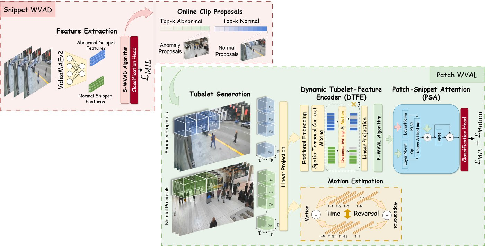
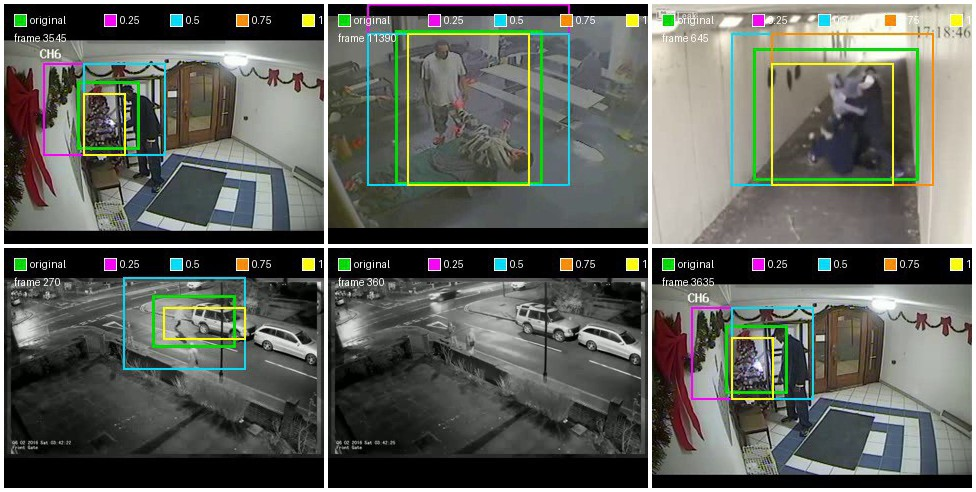

# SST-WSVADL

## Overview

This repository provides the official implementation for Sparse Spatio-temporal Weakly Supervised Video Anomaly Detection and Localization model (SST-WSVADL).   

Published at ECCV 2026 Workshop FAILED

>  **Localizing to Debias: A Patch-Level Benchmark and Baseline for Weakly Supervised Spatial Anomaly Detection**  
> Sara Abdulaziz, Abdulrahman Al-Abri, Giacomo D'Amicantonio, Egor Bondarev 
>
> [](https://arxiv.org/abs/2608.12045)
> [](./Supplementary.pdf)
> [](./LICENSE)



## Installation

### Requirements

- Python 3.8+
- PyTorch 1.8+
- CUDA-capable GPU

### Setup

1. Clone or copy this repository:
```bash
cd SST-WSVADL
```

2. Install dependencies:
```bash
pip install -r requirements.txt
```

## Dataset Preparation
__Option A:__ Download the dataset ([UCF-Crime](https://www.crcv.ucf.edu/projects/real-world/), [MSAD](https://msad-dataset.github.io/), [XD-Violence](https://roc-ng.github.io/XD-Violence/)), and extract video features using I3D or VideoMAEv2 public repositories. Then, prepare the dataset list files in the `list/` directory and paths in the configuration.

__Option B:__ Download our extracted VideoMAEv2 features, provided here [UCF-Crime](https://drive.google.com/file/d/1yzAbi5Gn64TcnGeCrRBC8L1T_E8Bmeas/view?usp=sharing), [MSAD](https://drive.google.com/file/d/1VarKcsR2HHydkdXKPujEqBqHLiLaLX2y/view?usp=sharing), [XD-Violence](https://drive.google.com/file/d/1-0HX5uSnzk1kk1qzxlakHpzFCqQ6JNlu/view?usp=sharing).

The `list/*.list` files ship with `/path/to/videos/` placeholders: point them at your own
video and feature directories before training or evaluating.


## Usage

### Training Structure

The training script structure demonstrates the two-stage training approach:
```bash
# Basic command structure (update paths and ensure dependencies)
python train.py \
    --dataset ucf \
    --batch_size 16 \
    --segment_length 16 \
    --num_tubelet 8 \
    --patch_size 16 \
    --resize 128 128 \
    --output_path ./outputs \
    --model_path ./models/exp_x \
    --video_root /path/to/videos \
    --test_file /path/to/ground_truth.npy
```

#### Spatial localization losses (optional)

The default patch branch reuses UR-DMU's MIL loss: the top `t//16+1` patch tokens
per clip. Nothing asks those patches to form one region or to depend on image
content. These opt-in flags add that pressure (all off by default, which leaves
training unchanged):

| flag | effect |
|---|---|
| `--spatial_pool window --pool_window 3` | MIL instance = best 3x3 window of the patch grid, so the region that fires is connected |
| `--contrast_loss_weight 1.0 --contrast_margin 0.3` | on anomalous clips, best region must beat the `--contrast_bottom_k` lowest patches by the margin; rules out constant maps |
| `--sparsity_loss_weight 0.1` | mean patch score on anomalous clips; only part of the frame fires |
| `--flip_equivariance_weight 1.0` | map of a mirrored clip must be the mirrored map; rules out maps tied to patch position |

`train.py` keeps the checkpoint with the best *temporal* AUC, which says nothing about the
spatial head, and also saves the final step as `<exp>_last`; evaluate both. Across seeds
the spatial metrics vary by more than any single-loss effect we measured
(up to ±0.064 spatial AUC over seeds 2022/2023/2024), so compare configurations on seed
means over at least three seeds, not on single runs.

### Patch-level evaluation protocol

> **Read this before comparing against SST-WSVADL.** Several details of this protocol can
> make weak spatial maps look better or worse than they are:
> - report **spatial PAUC / spatial PAP** — patch scores on GT frames, with no temporal
>   weighting — next to their chance levels (AUC 0.5; AP = the positive-patch rate, 0.452
>   on full-set GT frames and 0.337 on the Liu & Ma frames for the letterbox-free data);
> - treat paper-protocol PAUC/PAP as **mostly temporal**: multiplying by the frame score and
>   pooling normal frames mostly rewards the temporal branch;
> - compute AP with the step-wise estimator (`sklearn.metrics.average_precision_score`).
>   The trapezoidal integration of a PR curve is strongly optimistic under tied scores — a
>   constant map scores 0.726 where chance is 0.452 — and saturating spatial heads are
>   exactly that case. The legacy value is still written as `pap_trapezoid_legacy`;
> - report TIoU/TIoU_sub **only together with** its random top-k and full-frame baselines,
>   and read the sign caveat under "Reading the spatial maps" below;
> - use the **letterbox-free** data: 1462/1900 videos have black bars, heads learn to
>   down-score them, and a no-model box around the non-black patches alone scores
>   29.9–31.9% TIoU_sub;
> - **average over seeds**, and state which checkpoint you evaluated and how you chose it;
> - evaluate DTFE with the input range used in training ([0, 1], the default
>   `--input_range 0_1`). `0_255` reproduces the evaluation before this was fixed.

#### Patch vs. BBox ground truth

Released spatial annotations are in bounding box format, placed under `annotations/merged_*.json`. These include the annotations made by the annotation tool [`annotations/annotate.py`](./annotations/annotate.py). 

In order to derive the patch-level ground truths for the 8x8 patch scheme on 128x128 frame resolution, we measure thee patch to gt-bbox IoU overlap and assign a patch label `1` if it overlaps at least n% with the bounding box. We test n at [25,50,75,100]. The main paper reports metrics at 25% overlap (Table-5), whereas evaluations at other overlap thresholds are reported in supplementary (Table S10). The difference between boxes at the three thresholds is highlighted below. 

Colors: green = original · magenta = 0.25 · cyan = 0.50 · orange = 0.75 · yellow = 1.0




Note that for **UCF-Crime**, we further report _TIoU_sub_ which is computed based on [previous bbox annotations](https://github.com/xuzero/UCFCrime_BoundingBox_Annotation), applying the same patch-to-bbox quantization protocol above to obtain *bbox predictions* from patches.

#### Patch-label files shipped with this repository

The per-frame patch labels are binary and highly repetitive, so they are stored
bit-packed and deflated (`.npz`) instead of as raw arrays: UCF-Crime is 11 KB this
way rather than 568 MB, and unpacks to a bit-identical array.

| file | what it is |
|---|---|
| `frame_label/ucf_gt_patches_0.25.npz` | per-frame 8x8 patch GT, 25% overlap — the main-paper GT |
| `frame_label/ucf_gt_patches_0.5.npz` | same at 50% overlap (supplementary) |
| `frame_label/noletterbox/ucf_gt_patches_0.25.npz` | the same GT rebuilt for the letterbox-free videos |
| `frame_label/Liu_Ma_Test_{gt,subset_frames}_<n>.pkl` | the Liu & Ma subset used by TIoU_sub, quantized at overlap `<n>` |

`eval/patch_metrics.py::load_patch_gt` reads either format, and falls back to the
`.npz` when a `.npy` of the same name is absent, so `--patch_gt
frame_label/ucf_gt_patches_0.25.npy` still works. `save_patch_gt` writes the packed
form. To materialise a plain `.npy`:

```python
import numpy as np
from eval.patch_metrics import load_patch_gt
np.save("frame_label/ucf_gt_patches_0.25.npy",
        load_patch_gt("frame_label/ucf_gt_patches_0.25.npz"))
```

<code style="color : red">**IMPORTANT NOTE:**</code>   
How to use the annotations to reproduce our results or compare with SST-WSVADL performance:

1. If anomaly predictions are in form of bounding boxes: 
    + compare with our main-paper results by using the 0.25-quantized bounding-box annotations `annotations/*_0.25_quantized.json`
    + compare with our supplementary results at other overlap thresholds by using the `annotations/*_n_quantized.json`
    + compare with our results using the original bbox annotations (see table below).

2. If anomaly predictions are not boxes (e.g. attention / CAM heatmaps, soft score maps):
    + resize each frame’s map to **128×128**, then aggregate to an **8×8** patch grid
      (mean or max over each 16×16 cell) to obtain per-patch scores
    + evaluate with `eval/patch_evaluation_generic.py` against
      `frame_label/*_gt_patches_0.25.npz` (same overlap rule as the paper GT)
    + for **bbox TIoU**, threshold the patch map and convert active patches to a
      tight box (see `patches_to_bbox` in `eval/patch_metrics.py`), then score
      against `annotations/*_0.25_quantized.json`
    + do **not** compare continuous heatmaps directly to original boxes **unless** the comparison is made with the original-bbox-produced scores (see our supplementary). Otherwise, the comparison mixes resolution and label definitions with the paper protocol.


SST-WSVADL **bbox TIoU (%)** produced by the released checkpoints when scored
against each GT annotation file (original boxes vs overlap-quantized boxes).
Eval protocol matches the paper (bbox IoU + temporal gate). The **0.25** column
is the paper GT construction; `annotations/*_0.25_quantized.json` reproduces the same numbers as reconstructing GT boxes from the 0.25 patch maps.

### Running evaluation

1. <code style="color : salmon">Temporal Detection:</code>Export temporal frame-level scores once (JSON) before running the patch-level evaluation in the next step:
```bash
python eval/export_frame_scores.py \
    --model_dir models \
    --dataset ucf \
    --output predictions/frame_scores.json \
    --save_snippet_features
```

2. <code style="color : yellowgreen">Spatial Localization:</code> SST 8x8 evaluation (DTFE + spatial head):
```bash
python eval/patch_evaluation_sst.py \
    --model_dir models \
    --frame_scores predictions/frame_scores.json \
    --snippet_features predictions/frame_scores_snippet_features.npz \
    --video_root /path/to/ucf/videos \
    --output_dir outputs/patch_eval
```

BBox TIoU uses `annotations/*_0.25_quantized.json` by default. Pass
`--bbox_annotations ''` to fall back to reconstructing GT boxes from patch maps,
or point `--bbox_annotations` at another `*_n_quantized.json` / `*_original.json`.

3. Generic grid spatial evaluation (any HxW, from cached patch scores):
```bash
python eval/patch_evaluation_generic.py \
    --patch_preds outputs/patch_eval/patch_preds.npy \
    --frame_scores predictions/frame_scores.json \
    --grid_h 8 --grid_w 8
```

TIoU defaults to the paper protocol (legacy): frames without a GT box can still
contribute 0 when the temporal score is below threshold. Use
`--anomaly_frames_only` to average only over frames that have a GT box.
Use `--iou_mode patch` for binary patch-set IoU instead of the paper bbox protocol.

4. <code style="color : violet">TIoU_sub (UCF-Crime only):</code> the Liu & Ma annotation subset. Only the
frames that carry a [Liu & Ma bounding box](https://github.com/xuzero/UCFCrime_BoundingBox_Annotation)
are scored (3102 frames over 140 videos), using the same patch-to-bbox quantization:

```bash
python eval/patch_evaluation_liu_ma.py \
    --patch_preds outputs/patch_eval/patch_preds.npy \
    --frame_scores predictions/frame_scores.json \
    --metadata outputs/patch_eval/metadata.json \
    --overlap 0.25 \
    --patch_thresholds 0.1 0.3 0.5 0.7 \
    --topk 10 25
```

`--overlap` picks the GT quantization (`0.25` is the main-paper setting; `0.5`,
`0.75`, `1.0` are the supplementary ones). Note the `0.25` pickles are identical
to the un-suffixed legacy ones. `--topk` replaces thresholding with a per-frame
top-k patch selection, which is the fairer readout when patch scores are
concentrated in a narrow band. Gating conventions match
`eval/patch_evaluation_generic.py`: the default keeps annotated frames whose GT
is empty in the mean (scoring them 0), `--anomaly_frames_only` drops them.

#### The three stages end to end

For one experiment directory `outputs/<exp>`, seed 2022, on the letterbox-free data. Drop
the `--data_variant` / `annotations/noletterbox/` / `frame_label/noletterbox/` arguments to
run on the original videos.

```bash
EXP=41_nlb_rgb_base
VARIANT=noletterbox                       # or "" for the original videos
VIDEO_ROOT=/path/to/all_videos_${VARIANT}_resized128x128

# stage 1: temporal frame scores (+ snippet features reused by stage 2)
python eval/export_frame_scores.py \
    --model_dir outputs/$EXP --model_file urdmu_model_2022.pkl \
    --dataset ucf --data_variant $VARIANT \
    --output predictions/${EXP}_frame_scores.json --save_snippet_features

# stage 2: 8x8 patch scores + paper protocol (PAUC/PAP, spatial PAUC/PAP, TIoU)
python eval/patch_evaluation_sst.py \
    --model_dir outputs/$EXP \
    --stp_file dtfe_model_2022.pkl --spatial_file spatial_urdmu_model_2022.pkl \
    --frame_scores predictions/${EXP}_frame_scores.json \
    --snippet_features predictions/${EXP}_frame_scores_snippet_features.npz \
    --video_root $VIDEO_ROOT --data_variant $VARIANT \
    --patch_gt frame_label/$VARIANT/ucf_gt_patches_0.25.npz \
    --bbox_annotations annotations/$VARIANT/merged_ucf_crime_0.25_quantized.json \
    --video_sizes annotations/$VARIANT/ucf_video_sizes.json \
    --input_range 0_1 --output_dir outputs/patch_eval_$EXP \
    --patch_thresholds 0.1 0.3 0.5 0.7

# stage 3: Liu & Ma subset protocol (TIoU_sub)
python eval/patch_evaluation_liu_ma.py \
    --patch_preds outputs/patch_eval_$EXP/patch_preds.npy \
    --frame_scores predictions/${EXP}_frame_scores.json \
    --metadata outputs/patch_eval_$EXP/metadata.json \
    --liu_ma_dir frame_label/$VARIANT \
    --overlap 0.25 --iou_mode both \
    --patch_thresholds 0.1 0.2 0.3 0.4 0.5 0.6 0.7 0.8 0.9 \
    --topk 5 10 15 20 25 32 50 \
    --output outputs/patch_eval_$EXP/liu_ma_0.25.json
```

Add `--from_cache` to stage 2 to re-score maps that are already cached (after a metric
change, say) without re-running the model. `--token_order original` evaluates the spatial
head on raster-ordered tokens, as in training, rather than DTFE's keep-score order; it
changes spatial PAUC/PAP by at most 0.008, so the default `sorted` (the original protocol)
is kept.

The stages write JSON next to the cached maps: `paper_protocol.json` (PAUC/PAP, spatial
PAUC/PAP with chance, TIoU) and `liu_ma_0.25.json` (spatial AUC/AP on the Liu & Ma frames
with chance, TIoU_sub, random/full-frame baselines).

### Letterbox-free UCF-Crime

1462/1900 UCF-Crime videos contain black bars, and spatial heads learn to avoid them.
The letterbox-free variant crops them per video and rebuilds features and GT:

```bash
python tools/letterbox.py detect --out annotations/noletterbox/ucf_crops.json --workers 18
python tools/letterbox.py sheet --crops annotations/noletterbox/ucf_crops.json --out vis/letterbox_sheet.jpg
python tools/crop_videos.py --crops annotations/noletterbox/ucf_crops.json --workers 18
python tools/noletterbox_features.py prepare --shards 20
# then run the VideoMAEv2 extractor (unmodified, from its own repository) over each
# shard written by `prepare`, writing features to one directory; shards are independent
python tools/noletterbox_features.py check                  # 1900/1900 expected
python tools/noletterbox_gt.py --validate                   # must reproduce the original GT exactly
python tools/noletterbox_gt.py --crops annotations/noletterbox/ucf_crops.json
```

Train and evaluate on it with `--data_variant noletterbox`. `noletterbox_gt.py --validate`
is the important check: with full-frame crops it must reproduce the original patch GT,
quantized boxes and Liu & Ma pickles bit-for-bit, which is also the executable record of
how the released patch GT was constructed.

### Compare original vs quantized boxes

```bash
# Original vs released (0.25) JSON
python eval/overlay_bbox_comparison.py --dataset ucf --num_videos 5

# Original + overlap thresholds 0.25 / 0.50 / 0.75 / 1.0 (different colors)
python eval/overlay_bbox_comparison.py --dataset ucf \
    --thresholds 0.25 0.50 0.75 1.0 \
    --video_names Vandalism007_x264.mp4 Assault010_x264.mp4 Arson022_x264.mp4
```

Outputs: `vis/bbox_compare/{dataset}/` (pairwise) or `.../thresholds/` (multi).
Colors: green=original, magenta=0.25, cyan=0.50, orange=0.75, yellow=1.0.

### Visualization

**Heatmaps from cached predictions.** Once stage 2 above has cached patch
scores, `eval/visualize_heatmap.py` overlays the 8x8 patch-score heatmap on the
test videos and writes H.264 mp4s directly. It runs no model. The default is the
reference model `41_nlb_rgb_base` (best checkpoint) on the letterbox-free videos, and
several experiments can render side by side on the same frames:

```bash
python eval/visualize_heatmap.py --all_anomalous --num_normal 10 --pred_topk 10 \
    --output_dir vis/heatmaps_reference_noletterbox_input01
python eval/visualize_heatmap.py --exps 41_nlb_rgb_base 41_nlb_rgb_all --pred_topk 10 --per_class 2
python eval/visualize_heatmap.py --data_variant "" \
    --exps 37_ucf_random_agg 38_ucf_spatial_from_tokens --output_dir vis/heatmaps_37_vs_38
```

`--pred_topk 10` draws the box that TIoU_sub scores (red).

Each panel shows the heatmap, the 0.25-quantized GT box (green), and the temporal
score, with a temporal-score strip and cursor underneath. By default it renders
one anomalous video per class; `--videos Arson022 ...` picks specific ones,
`--include_normal` adds a normal video, and `--start` / `--max_frames` / `--stride`
trim the clip. Heatmaps are hidden below the temporal threshold (`--no-gate`
shows them everywhere) and min-max normalized per frame (`--norm frame`),
because raw spatial scores sit in a narrow band near 1; the raw range is printed
on each panel.

**Top-k patches from a live model.** `eval/visualize_topk.py` re-runs the model instead.
It overlays the top-k patch scores on video frames, then encodes those frames as mp4.

`--list` is a text file with one video or `.npy` feature path per line. Pass `--video_root` and `--feature_root` if the list only has filenames.

```bash
python eval/visualize_topk.py \
    --model_path ./models/exp_x \
    --list list/UCF_Test.list \
    --video_root /path/to/videos \
    --feature_root /path/to/features \
    --output_dir ./vis/topk \
    --cross_attention --motion_loss \
    --resize 128 128 --patch_size 16 --num_tubelet 8 --segment_length 16 \
    --token_ratio 1.0 1.0 1.0 \
    --mode topk --k 10
```

Frames are saved under `./vis/topk/<clip_name>/`. Convert them to video:

```bash
python eval/frames_to_video.py \
    --frames_dir ./vis/topk \
    --output_dir ./vis/topk/videos \
    --fps 25
```

`--mode bottomk` highlights the lowest-scoring patches. `--max_videos N` limits how many clips are processed. `--score_threshold 0.5` skips snippets below that temporal score.

## Future Work / Todo

[ ] Add soft-pruning feature  
[ ] Performance optimization  
[ ] RGB-thermal fusion support

## Acknowledgments

This implementation is based on:
- [UR-DMU](https://github.com/henrryzh1/UR-DMU.git)
- [STPrivacy](https://github.com/ming1993li/stprivacy.git)
- [DynamicViT](https://github.com/raoyongming/DynamicViT.git)

